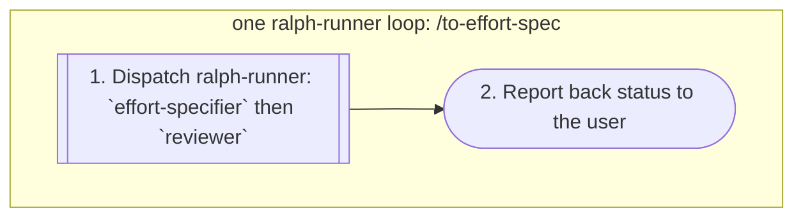

> **Run:** one `ralph-runner` loop around this prompt, shown as the wrapping subgraph. Walk the diagram in node order, one step per node: `[[ ]]` — dispatch a `ralph-runner` subagent (foreground); `[ ]` — run inline; `{ }` — branch on the `yes`/`no` edge; `([ ])` — report back to the user. Nested loops are always subagents, never inline.

